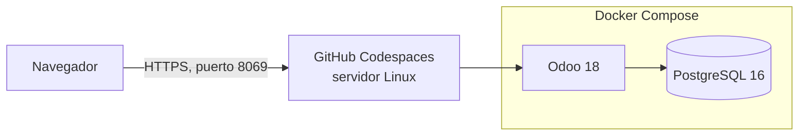
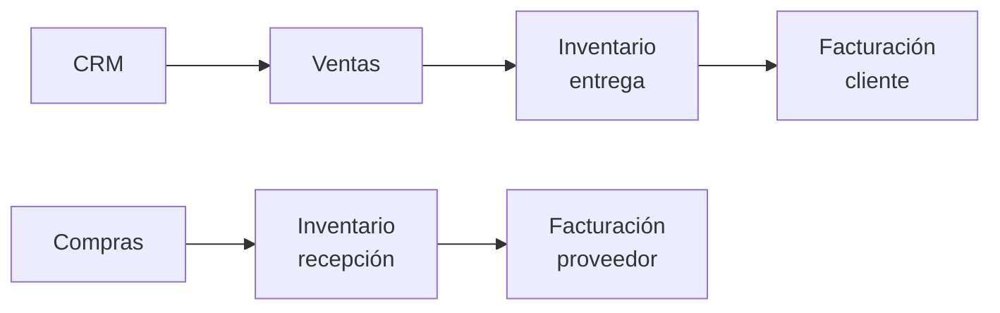
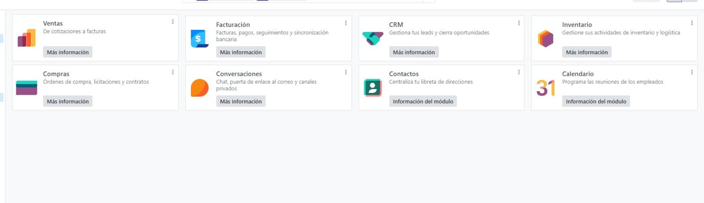
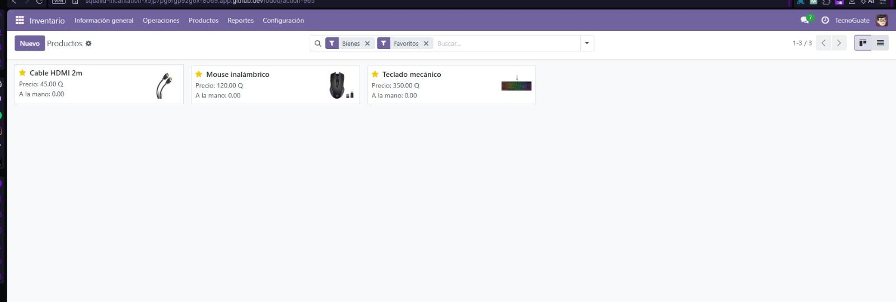
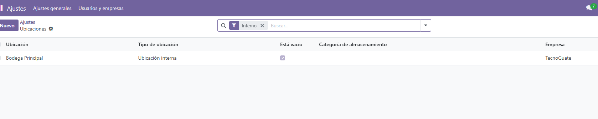
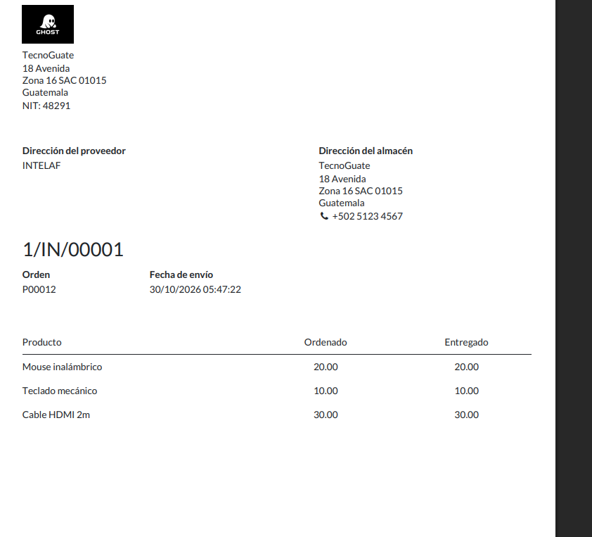
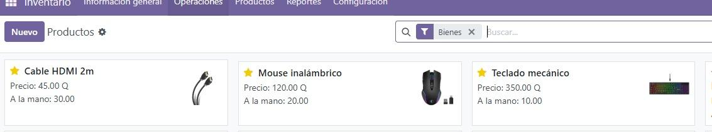
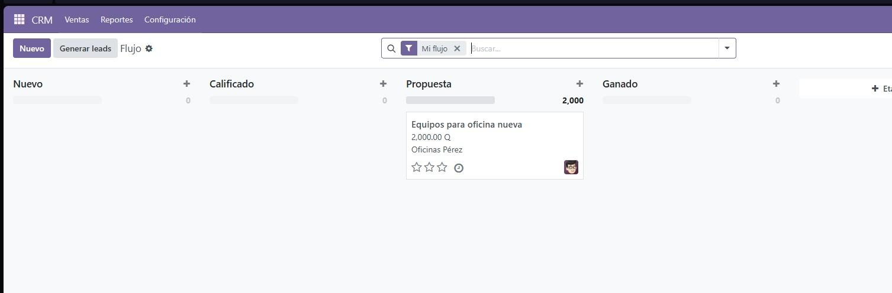

# ERP en la nube con Odoo 18 · TecnoGuate

Implementación de un ERP completo en la nube con **Odoo 18**, **Docker Compose** y **PostgreSQL 16**, desplegado en **GitHub Codespaces**. Se configuró una empresa de ejemplo, *TecnoGuate* (tienda de accesorios de tecnología en Guatemala), y se probó el flujo completo de negocio: oportunidad, compra, recepción, venta, entrega y factura.

> Proyecto de Ingeniería en Sistemas · Universidad Mariano Gálvez.

## Qué demuestra este proyecto

- Despliegue de una aplicación de varios servicios con Docker Compose.
- Configuración de un ERP real: empresa, almacén, productos, contactos e impuestos (IVA 12 %, moneda GTQ).
- Integración entre módulos: una venta baja el inventario y genera la factura sin reescribir datos.
- Carga masiva de datos con importación CSV.
- Resolución de problemas reales de infraestructura (ver [Decisiones y aprendizajes](#decisiones-y-aprendizajes)).

## Arquitectura



| Capa | Componente | Función |
|---|---|---|
| Cliente | Navegador web | Interfaz del ERP, sin instalar nada |
| Infraestructura | GitHub Codespaces | Servidor Linux en la nube |
| Contenedores | Docker y Docker Compose | Aíslan y ordenan los servicios |
| Aplicación | Odoo 18 (puerto 8069) | Lógica del ERP y módulos |
| Datos | PostgreSQL 16 | Base de datos, con volumen persistente |

## Módulos configurados

| Módulo | Uso en TecnoGuate |
|---|---|
| CRM | Oportunidades de venta por etapas |
| Ventas | Cotizaciones y pedidos de clientes |
| Compras | Pedidos a proveedores |
| Inventario | Almacén, ubicaciones y existencias |
| Facturación | Facturas a clientes y de proveedores |

### Diseño funcional



## Cómo ejecutarlo

Requisitos: Docker y Docker Compose (o un Codespace, que ya los trae).

```bash
git clone https://github.com/AntonyAquino/odoo-erp.git
cd odoo-erp
cp .env.example .env        # y cambia la clave dentro de .env
docker compose up -d
docker compose ps           # deben aparecer db y odoo activos
```

Abre `http://localhost:8069` (o la dirección pública del puerto 8069 en Codespaces) y crea la base de datos desde la pantalla inicial.

### Datos de ejemplo

`data/productos_tecnoguate.csv` contiene 20 productos de tecnología. Para cargarlos: **Inventario → Productos → ⚙ → Importar registros**.

## Prueba del flujo completo

| Paso | Acción | Resultado |
|---|---|---|
| 1 | Compra de 20 mouse, 10 teclados y 30 cables | Orden de compra confirmada |
| 2 | Validación de la recepción | Stock: 20, 10 y 30 |
| 3 | Venta de 5 mouse y 3 teclados | Orden de venta confirmada |
| 4 | Validación de la entrega | Stock: 15, 7 y 30 |
| 5 | Creación y confirmación de la factura | Factura publicada |
| 6 | Oportunidad en CRM con cotización | Oportunidad ganada |

## Capturas

| | |
|---|---|
|  |  |
|  |  |
|  |  |

## Decisiones y aprendizajes

- **Oracle Cloud descartado:** la capa gratuita falló con el error *Out of capacity* para el servidor ARM. Aprendí que las capas gratuitas dependen de la disponibilidad y que conviene tener una alternativa.
- **GitHub Codespaces elegido:** no requiere tarjeta, trae Docker y expone el puerto de Odoo.
- **Campo obligatorio "Entregar a":** Odoo no deja confirmar una compra sin indicar la operación de recepción del almacén.
- **Claves fuera del código:** la clave de la base de datos se lee desde `.env`, que está en `.gitignore`.

## Mejoras para producción

- Dominio propio con HTTPS (proxy inverso).
- Copias de seguridad periódicas de la base de datos.
- Servidor siempre activo (un Codespace se apaga por inactividad).
- Contraseñas robustas y acceso restringido al gestor de bases de datos.

## Autor

Steven Herrarte Aquino · [github.com/AntonyAquino](https://github.com/AntonyAquino)
